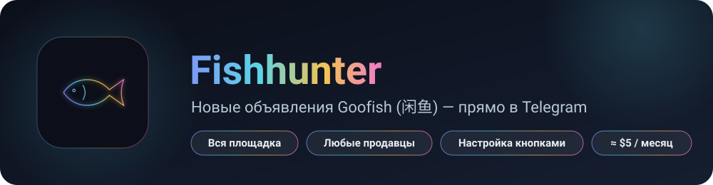
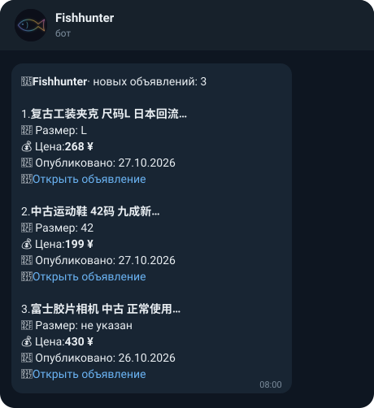
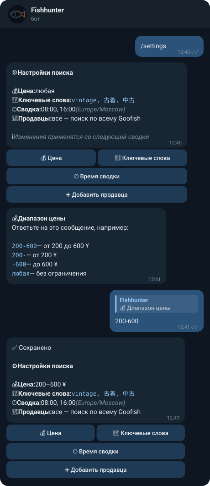
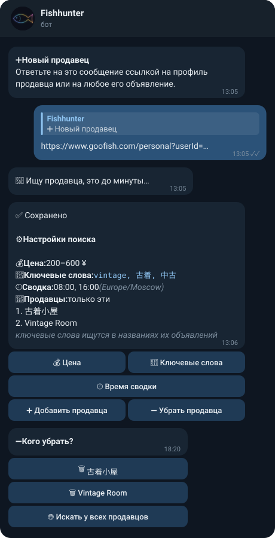
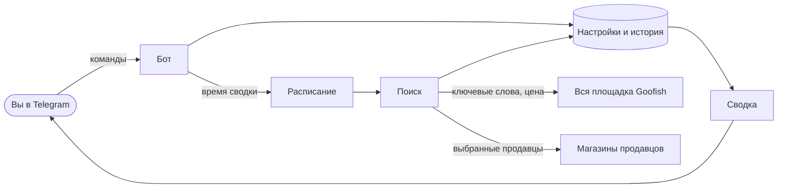

  

### Telegram-бот, который следит за Goofish (闲鱼) вместо вас

Ищет новые объявления **по всей площадке** или **у выбранных продавцов**
и в удобное вам время присылает аккуратную сводку. Всё настраивается прямо в Telegram.

---

## 💼 Зачем это вашему бизнесу

Перепродажа с Goofish держится на скорости: кто первым увидел выгодное объявление, тот и купил.
Fishhunter забирает на себя ежедневный ручной мониторинг, и вы тратите время на сделки, а не на поиск.

<table>
<tr>
<td width="50%" valign="top">

**⏱️ Экономия часов каждый день** 
Не нужно листать площадку вручную: поиск и отбор делает бот.

**⚡ Новое — первым** 
Сводка в выбранное время, до 6 раз в день — только объявления, которых вы ещё не видели.

**🎯 Только то, что нужно** 
Ключевые слова, диапазон цены, конкретные продавцы.

</td>
<td width="50%" valign="top">

**🏪 Слежка за поставщиками** 
Добавьте магазины одной ссылкой и получайте их новинки.

**📱 Всё в Telegram** 
Настройка кнопками под сообщением, ссылки открываются сразу в приложении 闲鱼.

**💸 Около $5 в месяц** 
Столько стоит сбор данных при двух сводках в день.

</td>
</tr>
</table>

## 👀 Как это выглядит

<table>
<tr>
<td align="center" width="50%" valign="top">
<b>📬 Сводка в выбранное время</b>  

</td>
<td align="center" width="50%" valign="top">
<b>⚙️ Настройка кнопками</b>  

</td>
</tr>
<tr>
<td align="center" valign="top">
<b>🏪 Слежка за выбранными продавцами</b>  

</td>
<td valign="top">
 
<b>Что в каждом объявлении сводки</b>
<ul>
<li>название</li>
<li>📏 размер — бот находит его в тексте объявления (<code>尺码L</code>, <code>42码</code>, <code>W30 L32</code>)</li>
<li>💰 цена в юанях</li>
<li>📅 дата публикации</li>
<li>🔗 ссылка, которая открывается в приложении 闲鱼</li>
</ul>
<b>Как меняются настройки</b>
<ul>
<li>нажмите кнопку под сообщением с настройками</li>
<li>бот спросит новое значение — просто ответьте</li>
<li>продавца убирают нажатием на его имя</li>
</ul>
<b>Почему это удобно</b>
<ul>
<li>каждое объявление приходит только один раз</li>
<li>в сводке — самые свежие, без завалов</li>
<li>если площадка недоступна, бот предупредит, а сводка всё равно придёт</li>
</ul>
</td>
</tr>
</table>

## ⚙️ Всё настраивается в боте

Под сообщением с настройками — кнопки. Нажали, ответили боту — готово.

| Кнопка | Что настраивает | Пример ответа |
|---|---|---|
| ➕ **Добавить продавца** | искать только у этого продавца | ссылка на его профиль или любое объявление |
| ➖ **Убрать продавца** | убрать одного или искать у всех | нажатие на имя продавца |
| 🔑 **Ключевые слова** | что искать | `vintage, 古着, 中古` |
| 💰 **Цена** | диапазон цены в ¥ | `200-600`, `200-`, `любая` |
| 🕗 **Время сводки** | когда приходит сводка, до 6 раз в день | `08:00, 16:00` |

Те же действия есть в меню бота командами: `/settings`, `/price`, `/keywords`, `/time`, `/seller_add`, `/seller_del`.

## 🔄 Как это работает

<table>
<tr>
<td align="center" width="33%"><h3>1️⃣</h3><b>Вы задаёте</b> что искать и когда: слова, цену, продавцов, время</td>
<td align="center" width="33%"><h3>2️⃣</h3><b>Бот ищет</b> по всему Goofish или у выбранных продавцов — в выбранное время</td>
<td align="center" width="33%"><h3>3️⃣</h3><b>Вы получаете</b> сводку только новых объявлений в Telegram</td>
</tr>
</table>

## 🔒 Безопасность

- ✅ **Только чтение.** Бот не входит в аккаунт Goofish и ничего на площадке не меняет.
- ✅ **Никаких личных данных:** ни платёжных данных, ни cookies, ни переписок, ни адресов.
- ✅ **Бот слушает только владельца.** Сообщения из чужих чатов отбрасываются непрочитанными.
- ✅ **Секреты под замком.** Токены хранятся только на сервере и никогда не попадают в логи и ответы бота.
- ✅ **Изолированный запуск.** Контейнер без прав администратора, файловая система только для чтения.

## 💰 Стоимость

| Что | Сколько |
|---|---|
| Сбор данных: поиск по всей площадке, 2 сводки в день | **≈ $5 / месяц** |
| Каждая дополнительная сводка в день | ≈ +$2,5 / месяц |
| Слежка за продавцом | ≈ $1,3 / месяц за продавца |
| Сервер | недорогой VPS (1 vCPU, 2 ГБ) |

## 🚀 Скоро

- [ ] Фильтр по размеру
- [ ] …и ещё много новых функций — проект активно развивается

---

<b>🛠 Для разработчиков: стек и инженерные решения</b>

 

**Стек:** Python 3.12 · httpx · SQLite · Docker Compose · Ubuntu 24.04 · Apify API · Telegram Bot API · pytest

- **Надёжность:** прогресс расписания хранится в БД — после перезапуска пропущенная сводка уходит ровно один раз; повторы с экспоненциальной задержкой и предупреждение в Telegram при сбоях; healthcheck, автоперезапуск и ежедневные проверенные бэкапы.
- **Безопасность:** площадка только читается, бот отвечает лишь владельцу, токены не попадают в логи (это проверяют тесты), контейнер без root и с файловой системой только для чтения.
- **Стоимость:** сравнил платные источники данных и снизил расход с ~$9,9 до ~$5 в месяц без потери качества сводки.
- **Тесты:** 102 теста на pytest, запросы к Telegram и Apify подменяются в тестах; ~1 250 строк кода.

<b>🇬🇧 English</b>

 

Fishhunter is a self-hosted Telegram bot that monitors Goofish (闲鱼, China's largest second-hand marketplace).
It searches the whole marketplace by keywords — or only the shops you choose — twice a day and sends a digest of
new listings: title, size, price, date and a link that opens in the Goofish app. Keywords, price range, sellers
and digest times are configured with bot buttons. Read-only by design: no marketplace account, cookies or personal data.
Data costs about $5/month. Python 3.12, SQLite, Docker, Apify API, Telegram Bot API, 102 tests.

 

**Исходный код закрыт** — доступ по запросу.

